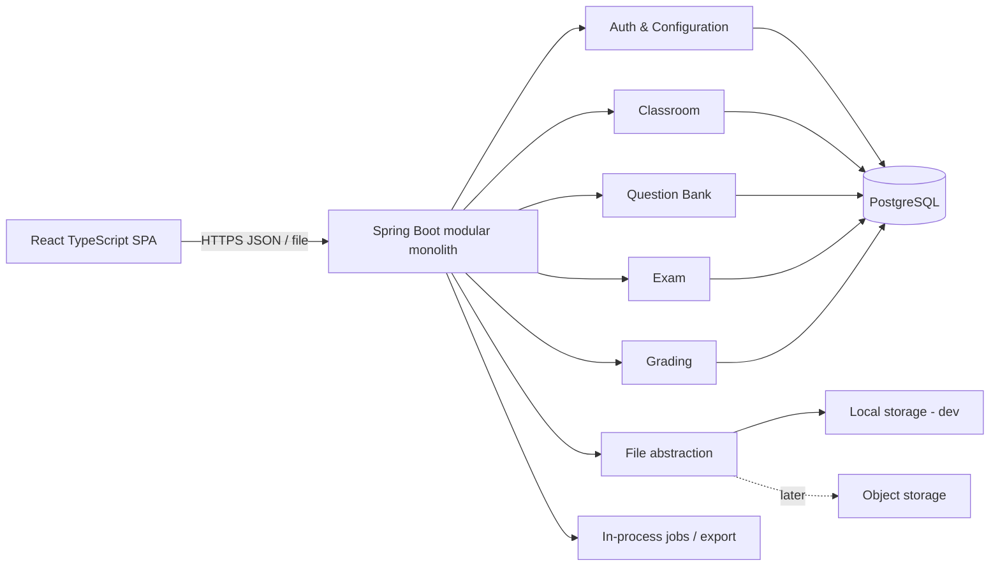
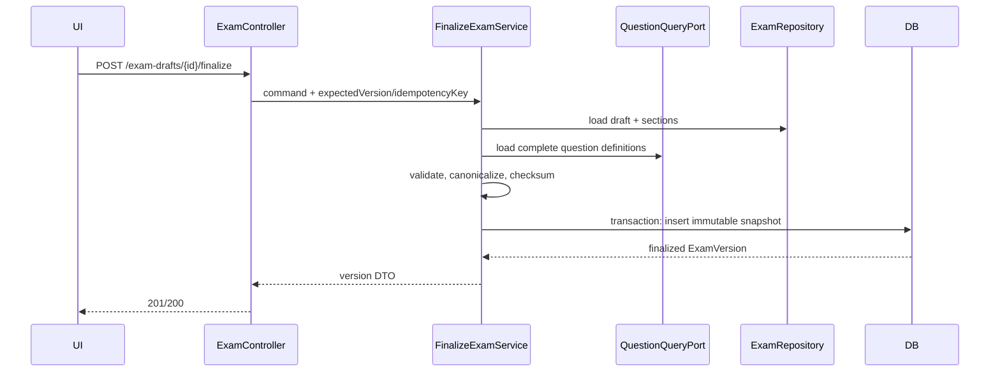
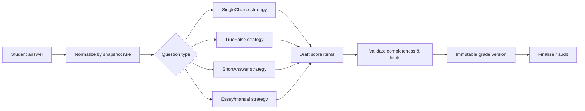

# Kiến trúc GeoTeacher

> Kiến trúc nền tảng modular monolith và technology stack là `CONFIRMED`. Cấu trúc chi tiết dưới đây là `PROPOSED` cho lần duyệt trước khi code.

## 1. Kiến trúc tổng thể



- Một deployable backend, một database, một frontend; module boundaries nằm trong source và dependency tests.
- Giao dịch cần nhất quán mạnh nằm trong cùng process/database. Đây là lý do modular monolith phù hợp hơn microservices cho MVP một người dùng.
- Không đưa domain logic vào controller, React component hay JPA callback.

## 2. Backend package-by-feature

```text
backend/
  src/main/java/com/geoteacher/
    auth/
    configuration/
    classroom/
    question/
    exam/
    grading/
    file/
    common/
```

Mỗi feature chỉ tạo lớp cần thiết, theo cấu trúc tham chiếu:

```text
<feature>/
  api/              controller, request/response DTO, API mapper
  application/      use-case service, command/query, transaction boundary
  domain/           entity/value object/policy/strategy, domain error
  infrastructure/   JPA entity/repository adapter, exporter/storage adapter
```

Không bắt buộc đủ bốn folder cho feature nhỏ. `common` chỉ chứa concern thật sự dùng chung (error envelope, clock, IDs), không trở thành “sọt rác”.

### Dependency rule

- `api → application → domain`.
- `infrastructure` triển khai port do application/domain cần.
- Module khác gọi application facade/public contract, không truy cập repository/entity nội bộ.
- `exam` được phép đọc question qua query contract để tạo draft, nhưng finalize copy snapshot vào ownership của exam.
- `grading` chỉ chấm từ exam snapshot/variant contract, không đọc đáp án hiện hành của question bank.

`PROPOSED`: dùng ArchUnit hoặc Spring Modulith verification để kiểm tra cycle/boundary; không bắt buộc event-driven hóa mọi tương tác.

## 3. Luồng dữ liệu quan trọng

### 3.1. Finalize đề



`FinalizeExamService` cần tồn tại vì đây là invariant xuyên nhiều bảng. Controller không tự copy entity; repository không quyết định nghiệp vụ.

### 3.2. Sinh mã đề

Generator nhận immutable version + policy + seed, tạo permutation thuần (pure) rồi validator kiểm tra mapping. Chỉ sau khi hợp lệ mới persist variant và answer key trong một transaction. Chấm dùng mapping đã lưu, không chạy random lần nữa.

### 3.3. Chấm và chốt điểm



Strategy trả không chỉ `BigDecimal` mà một kết quả gồm score, outcome/review reason và rule metadata (`PROPOSED`); điều này xử lý short answer mơ hồ an toàn hơn chữ ký chỉ trả số.

## 4. Frontend

```text
frontend/
  src/
    app/             router, providers, query client, layout
    features/
      auth/
      classroom/
      question/
      exam/
      grading/
    components/      UI dùng chung có chủ đích
    lib/             api client, formatting, validation helpers
    types/           kiểu dùng chung thực sự
```

- Server state: TanStack Query; form state: React Hook Form + Zod; không sao chép server cache sang global store tùy tiện.
- API schema là nguồn đồng bộ type; `PROPOSED` sinh TypeScript client/type từ OpenAPI sau khi API ổn định.
- Màn hình soạn đề desktop-first; route-level code splitting; guard thay đổi chưa lưu.
- API không trả answer key trong DTO danh sách/preview dành cho đề học sinh; endpoint đáp án riêng có chủ đích.

## 5. REST API đề xuất

Giữ resource-oriented API và tách command có state transition:

### Classroom/question

- `/api/v1/school-years`, `/class-groups`, `/students`, `/class-enrollments`
- `/api/v1/student-excel/template|preview|confirm|export` cho roster Excel; preview không ghi dữ liệu, confirm gọi lại cùng validator trong một transaction.
- `/api/v1/questions` hiện có CRUD/search/archive và detail cho `SINGLE_CHOICE`; `/questions/{id}/copy`, import và ba loại còn lại sẽ bổ sung ở các lát cắt sau.

### Document/file

- `GET /api/v1/documents` và `GET /api/v1/documents/{id}` — danh sách/chi tiết tài liệu cùng các đoạn và nhãn nguồn đã trích xuất.
- `POST /api/v1/documents` multipart — kiểm tra bytes PDF/DOCX, trích text, lưu binary qua `FileStorage`, rồi lưu metadata/chunk trong transaction.
- `POST /api/v1/documents/{id}/archive` — state transition dùng optimistic version; hiện không xóa binary.
- Adapter local dùng volume bền vững khi chạy Compose. Object storage, vector index, model provider và retention vẫn là điểm thay thế/chính sách chưa chốt.

### AI exam draft

- `GET /api/v1/ai/exam-drafts/status` — trạng thái provider/model; không trả API key.
- `POST /api/v1/ai/exam-drafts/generate` — chọn mục đích, 15/45/60 phút, giáo trình, đề mẫu và consent; service lấy đoạn có scope, gọi `AiModelGateway`, validate rồi mới lưu.
- `GET /api/v1/ai/exam-drafts` — danh sách draft đầy đủ cho giáo viên review; không phải endpoint đề finalized.
- Adapter Gemini dùng Interactions API với structured output và `store=false`; không upload binary và không gửi dữ liệu học sinh. Provider khác vẫn có thể thay qua interface.

### Exam

- `POST /api/v1/exams` — tạo catalog + draft đầu.
- `GET/PUT /api/v1/exam-drafts/{id}` — chỉnh draft, dùng version/ETag chống lost update.
- `POST /api/v1/exam-drafts/{id}/finalize` — tạo immutable version.
- `POST /api/v1/exam-versions/{id}/revisions` — tạo draft revision.
- `POST /api/v1/exam-versions/{id}/variants` — sinh mã đề.
- `GET /api/v1/exam-variants/{id}/exports?format=docx|pdf`.
- `GET /api/v1/exam-variants/{id}/answer-key` — endpoint nhạy cảm riêng.

Thay đổi so với draft ban đầu: tài nguyên draft/version/variant tách rõ để không thể `PUT /exams/{id}` làm thay đổi đề đã chốt; export xác định chính xác mã đề.

### Grading

- `/api/v1/exam-sessions`, `/exam-sessions/{id}/roster`, `/exam-sessions/{id}/results`.
- `POST /api/v1/submissions`; `PUT /submissions/{id}/answers`.
- `POST /api/v1/submissions/{id}/auto-grade`.
- `PUT /api/v1/submissions/{id}/manual-scores`.
- `POST /api/v1/submissions/{id}/finalize`.
- `POST /api/v1/grades/{id}/adjustments` — tạo version mới, không PUT mất lịch sử.
- `/recognize` và upload scan giữ `DEFERRED`; upload file chung có thể tồn tại nhưng không hứa nhận dạng MVP.

### API conventions

- Error envelope có `code`, message thân thiện, field errors, correlation ID; không lộ stack trace.
- Pagination/sort/filter allowlist; thời gian ISO-8601; decimal truyền dạng JSON number hoặc string nhất quán (`OPEN`).
- Lệnh retry-risk dùng idempotency key; optimistic conflict trả `409` hoặc `412` nhất quán (`PROPOSED`).
- OpenAPI mô tả contract; integration tests khóa endpoint nhạy cảm.

## 6. Security

- `PROPOSED` Spring Security với server-side session cookie cho same-origin deployment; đơn giản và ít rủi ro token storage hơn JWT trong SPA một người dùng.
- CSRF protection, CORS deny-by-default, rate limit/login throttling, password hash BCrypt với cost cấu hình được.
- Authorization vẫn kiểm tra authenticated user ở backend dù chỉ một role; không dựa vào ẩn nút UI.
- Secret/config production qua environment/secret store, không commit. HTTPS ở reverse proxy hoặc application edge.
- Log không chứa password, reset token, đáp án học sinh đầy đủ hoặc dữ liệu cá nhân không cần thiết.

## 7. Persistence, transaction và concurrency

- Flyway là nguồn schema; `ddl-auto=validate` ngoài test.
- Transaction boundary ở application command service. Query read-only dùng projection.
- Optimistic locking cho draft question/exam/submission; unique constraint là hàng rào cuối cho duplicate.
- `READ COMMITTED` đủ cho phần lớn lệnh; lock/pessimistic hoặc retry chỉ tại finalize/adjust nếu race thực sự (`PROPOSED`).
- Export không thay đổi domain; với file lớn, tạo job record và chạy executor có giới hạn. Không thêm broker trong MVP.

## 8. File và export

- Port `FileStorage` với local adapter ở dev và object-storage adapter về sau.
- Database lưu metadata/checksum/storage key; không lưu path do người dùng cung cấp.
- DOCX bằng Apache POI. PDF library (`PDFBox` hay `OpenPDF`) là `OPEN`; cần spike tiếng Việt, bảng, ảnh, font embedding trước khi chốt.
- Export phải đọc snapshot/variant, không đọc question bank live.

## 9. Observability và vận hành

- Structured application logs + correlation ID; health/readiness; metric cơ bản cho lỗi/export duration.
- Docker Compose cho local PostgreSQL; application có profile rõ, không tự apply seed production nguy hiểm.
- Backup/restore phải được thử nghiệm trước production; không chỉ viết script backup.

## 10. Test strategy

- Unit: value object/validator/grading strategy/permutation generator/state machine.
- Persistence: Testcontainers PostgreSQL cho constraint, JSONB, partial index và Flyway.
- API: security, validation, answer leakage, optimistic/idempotent commands.
- Contract/frontend: generated types hoặc schema tests; component test các form quan trọng.
- End-to-end tối thiểu: tạo lớp → câu hỏi → finalize đề → variant → submission → grade → finalize → adjustment/export.
