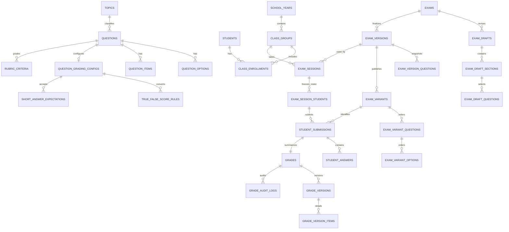

# Thiết kế cơ sở dữ liệu GeoTeacher

> Trạng thái: toàn bộ schema chi tiết trong tài liệu này là `PROPOSED`, trừ những invariant được dẫn từ `BUSINESS_RULES.md`. Mục tiêu là PostgreSQL + Spring Data JPA, chưa phải migration đã chốt.

## 1. Kết luận rà soát mô hình ban đầu

Mô hình ban đầu đúng hướng nhưng **chưa đủ** để bảo toàn lịch sử và chấm xác định. Cần điều chỉnh:

1. Tách `Class`–`Student` bằng enrollment là đúng; cần ràng buộc thời gian/trạng thái và chính sách mã học sinh.
2. `question_grading_configs` đơn lẻ chưa biểu diễn đầy đủ bảng điểm true/false, đáp án ngắn, rubric.
3. `exam_questions` và `exam_version_questions` chưa đủ cho section, nhóm ngữ liệu, matrix, snapshot attachment và mapping option.
4. Submission phải tham chiếu **exam variant**, không chỉ exam version.
5. `grades` + `grade_audit_logs` chưa đủ tái dựng lịch sử; cần grade version + item snapshot bất biến.
6. Cần roster snapshot cho đợt kiểm tra và file asset dùng chung có checksum/chính sách không xóa.

## 2. Quy ước dữ liệu

- PK: UUID sinh phía ứng dụng hoặc database; mọi bảng có `created_at timestamptz`, bảng mutable có `updated_at timestamptz` và `version bigint` cho optimistic locking.
- Điểm: `numeric(7,3)`; tỷ lệ/tolerance dùng precision phù hợp, không dùng `float/double`.
- Enum: `varchar` + `CHECK` cho tập ổn định; bảng lookup cho dữ liệu người dùng cấu hình. Tránh PostgreSQL native enum để migration dễ hơn.
- Mã hiển thị (`student_code`, `variant_code`) không làm PK.
- JSONB chỉ dùng cho payload có cấu trúc biến thiên/snapshot render; trường cần join, unique, FK hoặc filter thường xuyên phải là cột/bảng quan hệ.
- Tên bảng snake_case, FK dạng `<entity>_id`. Không dùng cascade delete qua dữ liệu lịch sử.

## 3. ERD mức aggregate

## 4. Bảng đề xuất

### 4.1. Auth và configuration

#### `users`

- `id` PK; `username`/`email`; `password_hash`; `display_name`; `status`; `last_login_at`; timestamps/version.
- UNIQUE trên `lower(username)`; UNIQUE nullable trên `lower(email)`.
- CHECK status: `ACTIVE`, `LOCKED`, `DISABLED`.
- Không soft-delete tài khoản có audit; disable bằng status.

#### `password_reset_tokens`

- `id`, `user_id` FK, `token_hash` UNIQUE, `expires_at`, `used_at`, `created_at`.
- Chỉ lưu hash token. Index `(user_id, expires_at)`; dọn token hết hạn theo job.

#### `app_settings`

- `id`, `setting_key`, `value_json`, `schema_version`, timestamps/version.
- UNIQUE `setting_key`. Chỉ chứa cấu hình không cần quan hệ; năm học/mẫu đề có bảng riêng.

#### `exam_templates`

- Metadata template, file asset và trạng thái. Cần khi chức năng mẫu đề được triển khai; có thể để sau lát cắt auth.

### 4.2. Classroom

#### `school_years`

- `id`, `code`, `start_date`, `end_date`, `status` (`PLANNED`,`ACTIVE`,`ARCHIVED`).
- UNIQUE `code`; CHECK `start_date < end_date`; partial UNIQUE chỉ một `ACTIVE` (`WHERE status='ACTIVE'`) nếu nghiệp vụ xác nhận.

#### `class_groups`

- `id`, `school_year_id` FK RESTRICT, `class_code`, `display_name`, `grade_level`, `status`.
- UNIQUE `(school_year_id, class_code)`; index `(school_year_id, status)`.
- Dùng tên `class_groups` để tránh mơ hồ với từ khóa/lớp Java.

#### `students`

- `id`, `student_code`, `full_name`, `date_of_birth`, `gender` nullable, `status`, contact fields tối thiểu.
- `CONFIRMED` `student_code` unique toàn hệ thống; migration V4 lưu thêm giá trị normalized để chặn trùng không phân biệt hoa/thường.
- Index normalized name cho tìm kiếm; cân nhắc `pg_trgm` sau khi đo nhu cầu.

#### `class_enrollments`

- `id`, `class_group_id` FK, `student_id` FK, `enrolled_at`, `left_at`, `status`.
- UNIQUE `(class_group_id, student_id)`; CHECK thời gian hợp lệ; index `(student_id, status)` và `(class_group_id, status)`.
- Không xóa enrollment đã được `exam_session_students` tham chiếu.

### 4.3. File asset dùng chung

#### `file_assets`

- `id`, `storage_provider`, `storage_key`, `original_name`, `media_type`, `size_bytes`, `sha256`, `status`, timestamps.
- UNIQUE `(storage_provider, storage_key)`; index `sha256` để phát hiện trùng.
- `storage_key` do server tạo, không tin tên upload. File đang được snapshot tham chiếu chỉ được mark `RETAINED/ARCHIVED`, không xóa vật lý.

> Hiện trạng triển khai: migration V7 đã tạo `file_assets` với provider/key, metadata, SHA-256, trạng thái và optimistic version; binary được lưu sau abstraction `FileStorage`.

#### `source_documents` và `document_chunks`

- `source_documents` liên kết một `file_asset`, lưu tiêu đề, khối lớp tùy chọn, trạng thái, số ký tự/đoạn và optimistic version.
- `document_chunks` lưu thứ tự đoạn, số trang nullable, nhãn nguồn, nội dung và số ký tự. Đây là nền citation/retrieval; vector embedding và scope retrieval chưa được chọn.
- Migration V7 đã triển khai hai bảng này cho PDF/DOCX có text. Archive hiện giữ binary; retention/xóa vật lý còn `OPEN` theo O-017.
- Migration V8 thêm `document_kind = KNOWLEDGE | SAMPLE_EXAM` để tách nguồn kiến thức khỏi khuôn đề.

#### `ai_exam_drafts` và `ai_exam_draft_sources`

- V8 lưu draft AI gồm mục đích đề, thời lượng, khối, provider/model, structured content JSONB và thời điểm tạo.
- Bảng nguồn liên kết từng draft với giáo trình (`KNOWLEDGE`) và đề mẫu (`SAMPLE`); draft không phải exam finalized và chưa được dùng trực tiếp để chấm.

### 4.4. Question bank

> Hiện trạng triển khai: migration V5/V6 đã tạo `questions` và `question_options` cho lát cắt `SINGLE_CHOICE`; V7 bổ sung nền file/document độc lập. Các bảng taxonomy, grading config, item/rubric và attachment bên dưới vẫn là thiết kế mục tiêu `PROPOSED`.

#### `topics`

- `id`, `parent_id` self-FK, `code`, `name`, `grade_level`, `status`, sort order.
- UNIQUE `(parent_id, code)` (cần xử lý root null bằng index biểu thức); index `(grade_level, status)`.
- Cấu trúc cây biểu diễn chương/bài/chủ đề; chống cycle ở service hoặc trigger.

#### `cognitive_levels`

- `id`, `code`, `name`, `sort_order`, `status`.
- UNIQUE `code`. Seed bốn mức hiện tại nhưng cho phép cấu hình/retire.

#### `questions`

- `id`, `type`, `content_json`, `grade_level`, `topic_id`, `cognitive_level_id`, `explanation_json`, `suggested_score`, `status`, timestamps/version.
- CHECK type thuộc bốn loại; CHECK score > 0 nếu có.
- Index `(status, type, grade_level)`, `(topic_id, cognitive_level_id, status)`, GIN cho search document nếu cần.
- `DRAFT`/chưa dùng có thể xóa; đã được snapshot chỉ archive.

#### `question_options`

- Cho `SINGLE_CHOICE`: `id`, `question_id`, `option_key`, `content_json`, `is_correct`, `sort_order`, `shuffleable`.
- UNIQUE `(question_id, option_key)` và `(question_id, sort_order)`.
- Constraint “đúng một correct option” cần deferred constraint trigger hoặc service + integration test; partial unique chỉ đảm bảo tối đa một.

#### `question_items`

- Cho `TRUE_FALSE`: `id`, `question_id`, `item_key`, `content_json`, `correct_value`, `sort_order`, `shuffleable`.
- UNIQUE `(question_id, item_key/sort_order)`; `correct_value NOT NULL` khi active/finalize.

#### `question_grading_configs`

- `id`, `question_id` UNIQUE FK, `mode`, `max_score`, `rounding_scale`, `rounding_mode`, `unit_policy`, `config_json`, `schema_version`.
- `config_json` chỉ chứa tùy chọn ít truy vấn; validator phụ thuộc `type/mode`.

#### `true_false_score_rules`

- `id`, `grading_config_id`, `correct_count`, `score_ratio`.
- UNIQUE `(grading_config_id, correct_count)`; CHECK count >= 0, ratio 0..1.
- Service đảm bảo đủ `0..N` và monotonic trước khi activate/finalize.

#### `short_answer_expectations`

- `id`, `grading_config_id`, `answer_kind`, `text_value`, `numeric_value`, `unit_code`, `absolute_tolerance`, `relative_tolerance`, `sort_order`.
- CHECK đúng tập cột theo `answer_kind`; index `grading_config_id`.

#### `rubric_criteria`

- `id`, `question_id`, `parent_id` nullable, `criterion_key`, `description_json`, `max_score`, `sort_order`.
- UNIQUE `(question_id, criterion_key)`; tổng max criterion không vượt max question (service/deferred validation).

#### `question_attachments`

- `question_id`, `file_asset_id`, `role`, `sort_order`, caption/alt text.
- PK hoặc UNIQUE `(question_id, file_asset_id, role)`.

### 4.5. Exam draft, immutable version và variant

#### `exam_types`

- `id`, `code`, `name`, `status`, `sort_order`; UNIQUE `code`.
- Seed các loại được nêu nhưng cho phép thêm/retire, đáp ứng yêu cầu không hard-code.

#### `exams`

- Identity ổn định của một chuỗi revision: `id`, `title`, `subject_code` (mặc định Geography), `grade_level`, `catalog_status`, timestamps.
- `catalog_status`: `ACTIVE`, `ARCHIVED`; không mang nghĩa “draft/finalized” của version.

#### `exam_drafts`

- `id`, `exam_id`, `revision_no`, `based_on_version_id` nullable, metadata (type/year/duration/total score/template), timestamps/version.
- UNIQUE `(exam_id, revision_no)`; partial UNIQUE một draft đang mở trên mỗi exam (`closed_at IS NULL`) nếu chọn chính sách này.

#### `exam_draft_sections`

- `id`, `exam_draft_id`, `section_key`, `title`, `question_type` nullable, `sort_order`, `max_score`, `shuffleable`.
- UNIQUE draft+key và draft+sort.

#### `exam_draft_questions`

- `id`, `section_id`, `question_id` FK, `sort_order`, `max_score`, `shuffle_group_key`, `shuffleable`, `option_shuffleable`.
- UNIQUE `(section_id, sort_order)`; có thể ngăn câu trùng trong draft bằng UNIQUE phù hợp hoặc cho phép rõ (`OPEN`).

#### `exam_matrix_rules`

- `id`, `exam_draft_id`, `topic_id`, `lesson_topic_id` nullable, `question_type`, `cognitive_level_id`, `question_count`, `score_total`.
- UNIQUE tuple dimensions; CHECK count > 0, score > 0.

#### `exam_versions`

- `id`, `exam_id`, `source_draft_id`, `version_no`, `status`, metadata snapshot, `snapshot_schema_version`, `snapshot_checksum`, `finalized_at`, `archived_at`.
- UNIQUE `(exam_id, version_no)`; UNIQUE `source_draft_id`; status `FINALIZED`/`ARCHIVED` (draft nằm bảng riêng).
- Không có `UPDATE` nội dung; chỉ transition archive qua command được phép.

#### `exam_version_sections`

- Snapshot section: `id`, `exam_version_id`, key/title/order/max score và policy đảo.
- UNIQUE version+key/order.

#### `exam_version_questions`

- `id`, `exam_version_section_id`, `source_question_id` nullable FK RESTRICT, stable key, order, max score, shuffle group/policies, `content_snapshot jsonb`, `grading_snapshot jsonb`, `snapshot_checksum`.
- Snapshot JSON có schema version và stable keys của option/item/rubric. Không join về bảng question để render/chấm.
- UNIQUE `(section_id, stable_key)` và `(section_id, sort_order)`.

#### `exam_version_attachments`

- `id`, `exam_version_question_id`, `file_asset_id` FK RESTRICT, role/order, `sha256_snapshot`, metadata snapshot.
- Bảo đảm binary được retain; checksum phát hiện file sai.

#### `exam_variants`

- `id`, `exam_version_id`, `variant_code`, `seed`, `generator_version`, `status`, `mapping_checksum`, timestamps.
- UNIQUE `(exam_version_id, variant_code)`; status `DRAFT`,`PUBLISHED`,`RETIRED` (`PROPOSED`). Published mapping bất biến.

#### `exam_variant_questions`

- `id`, `exam_variant_id`, `exam_version_question_id`, `printed_section_order`, `printed_question_order`, `printed_number`.
- UNIQUE variant+version question; UNIQUE vị trí in trong section.

#### `exam_variant_options`

- `id`, `exam_variant_question_id`, `snapshot_option_key`, `printed_label`, `printed_order`.
- UNIQUE question+key/label/order. `snapshot_option_key` phải tồn tại trong grading snapshot; validator khi publish.

#### `exam_variant_answer_keys`

- `id`, `exam_variant_question_id` UNIQUE, `answer_key_snapshot jsonb`, `max_score`, checksum.
- Có thể suy ra từ snapshot + mapping, nhưng lưu explicit giúp audit/export; publish validator so sánh hai nguồn để ngăn lệch.

### 4.6. Grading

#### `exam_sessions`

- `id`, `class_group_id`, `exam_version_id`, `name`, `held_at`, `status`, timestamps/version.
- Chỉ version finalized được dùng; index class/date và version.
- `OPEN`: một session dùng tất cả variant của version hay subset; nếu subset, thêm bảng `exam_session_variants`.

#### `exam_session_students`

- Roster snapshot: `id`, `exam_session_id`, `student_id`, `class_enrollment_id` nullable, `student_code_snapshot`, `student_name_snapshot`, `attendance_status`.
- UNIQUE `(exam_session_id, student_id)`; giữ tên/mã thời điểm kiểm tra nhưng vẫn liên kết student gốc.

#### `student_submissions`

- `id`, `exam_session_student_id`, `exam_variant_id`, `status`, `official`, `replaces_submission_id` nullable, timestamps/version.
- Partial UNIQUE một official hiện hành trên mỗi session student, ví dụ `WHERE official AND status <> 'REPLACED'`.
- FK/service bảo đảm variant thuộc version của session.

#### `student_answers`

- `id`, `submission_id`, `exam_variant_question_id`, `answer_payload jsonb`, `answer_status`, `source`, confidence nullable, timestamps/version.
- UNIQUE `(submission_id, exam_variant_question_id)`.
- Payload được validate theo question type/schema version; không lưu nhãn A như nguồn sự thật nếu có thể lưu option key.

#### `submission_files`

- `submission_id`, `file_asset_id`, type/page/order/recognition status; unique phù hợp.
- Dùng về sau cho scan/OMR nhưng có thể hỗ trợ file minh chứng MVP.

#### `grades`

- `id`, `submission_id` UNIQUE, `status`, `current_version_id` nullable, timestamps/version.
- FK `current_version_id` được thêm sau khi tạo bảng versions; service bảo đảm version cùng grade.

#### `grade_versions`

- `id`, `grade_id`, `version_no`, `supersedes_version_id` nullable, objective/essay/total scores, comment, `change_reason`, `created_by`, `finalized_at`, checksum.
- UNIQUE `(grade_id, version_no)`; immutable sau insert.

#### `grade_version_items`

- `id`, `grade_version_id`, `exam_version_question_id`, `score`, `max_score_snapshot`, `source`, `rule_snapshot jsonb`, feedback.
- UNIQUE `(grade_version_id, exam_version_question_id)`; CHECK `0 <= score <= max_score_snapshot`.

#### `grading_reviews`

- `id`, `submission_id`, optional answer/question, `reason_code`, details, status, resolved_by/at/resolution.
- Index `(status, submission_id)`; finalize bị chặn nếu còn review bắt buộc đang mở.

#### `grade_audit_logs`

- Append-only event: `id`, `grade_id`, `from_version_id`, `to_version_id`, `event_type`, `actor_id`, `reason`, `before_summary jsonb`, `after_summary jsonb`, `created_at`.
- Không thay thế grade versions; giúp tra cứu nhanh ai/lý do/khác biệt.

## 5. Bất biến và enforcement

| Bất biến | Database | Service/domain |
|---|---|---|
| Một đáp án đúng single choice | partial unique tối đa 1 | yêu cầu đúng 1 trước activate/finalize |
| Tổng điểm đề | CHECK điểm dương | tính lại section/question bằng BigDecimal |
| Snapshot bất biến | REVOKE update/delete hoặc trigger cho bảng snapshot; FK RESTRICT | không expose update repository/use case |
| Variant thuộc đúng version session | FK từng phía | validate cross-aggregate trong transaction |
| Một bài chính thức | partial unique index | quy trình replace rõ ràng |
| Điểm không vượt max | CHECK item | tổng hợp và rounding theo snapshot |
| Grade history không mất | FK RESTRICT/append-only | adjustment command tạo version + audit |

## 6. Index trọng yếu

- Tất cả FK dùng cho join/list cần B-tree index (PostgreSQL không tự tạo index cho FK).
- Question filters: `(status, grade_level, type)`, `(topic_id, cognitive_level_id, status)`.
- Exam catalog: `(catalog_status, grade_level, created_at desc)`; versions `(exam_id, version_no desc)`.
- Sessions/results: `(class_group_id, held_at desc)`, submissions `(exam_session_student_id, status)`, reviews `(status, created_at)`.
- Student search: unique student code; normalized name index chỉ thêm sau đo query.
- Không tạo index mọi cột; xác nhận bằng `EXPLAIN ANALYZE` khi có dữ liệu đại diện.

## 7. Xóa, archive và retention

- Hard delete chỉ cho draft chưa có tham chiếu và file upload orphan sau thời gian an toàn.
- Archive: school year, class, student/question/exam catalog; dữ liệu lịch sử vẫn đọc được.
- Snapshot, variant đã publish, submission/grade finalized, grade version/audit: không hard delete qua ứng dụng.
- Chính sách retention/backups và dữ liệu học sinh khi không còn sử dụng là `OPEN`, cần chốt trước production.

## 8. Rủi ro JPA cần tránh

- Không map aggregate lớn bằng `EAGER`; dùng projection/entity graph/query rõ ràng để tránh N+1.
- Không cascade `REMOVE` từ exam/question sang snapshot/history.
- Không dựa vào `orphanRemoval` cho dữ liệu lịch sử.
- Dùng `@Version` cho draft/mutable root; transaction boundary ở application service.
- JSONB cần converter/type được test; canonical serialization và checksum không phụ thuộc thứ tự key.
